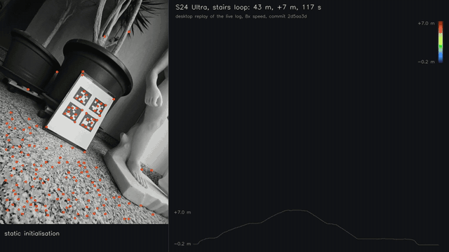

# pocketvio

**Real-time IMU-centric visual-inertial odometry on Android: an MSCKF in C++ with a Vulkan compute front-end, running on the phone in your pocket.**

[](https://github.com/Artemarius/pocketvio-app/releases/latest)
[](LICENSE)


<p align="center">
  
</p>

<p align="center"><sub>
A Galaxy S24 Ultra carried up two floors of a stairwell and back down: 117 s, 43 m, +7 m. The phone ran the filter live and recorded its own sensor input. This is the desktop replay of that recording at 8× speed: the camera frames with their tracks, the trajectory and the triangulated map coloured by height. Back on its starting spot the estimate is 0.29 m from where AprilTags say the phone is (0.68 % of the path, Protocol 43). The live run ended 5 cm from this replay.
</sub></p>

This repository holds the **1.0.0 release** (the Android app, the Linux replay and calibration tools, a sample log), the main write-ups, the media and an 18-slide [presentation (PDF)](https://github.com/Artemarius/pocketvio-app/releases/download/v1.0.0/pocketvio-1.0.0-deck.pdf). The source code is not in this repository.

## What it is

- **An MSCKF that runs in real time on the phone.** Error-state IMU propagation from preintegrated increments, a sliding window of IMU-pose clones, one-shot feature updates with nullspace projection. The camera–IMU time offset and extrinsics are filter states. 3.7 ms median per frame live on the S24 Ultra, of which 1.2 ms is arithmetic and the rest the CPU clock the phone grants it ([pipeline](docs/pipeline.md)).
- **IMU first.** The raw (`*_UNCALIBRATED`) gyroscope and accelerometer drive the state, at 475 Hz. Their noise comes from multi-hour Allan variance and rate-dependent terms measured on hand spins. Their scale, misalignment and frame rotation come from a multi-position calibration and are applied at the boundary. Android's fused outputs never enter the filter.
- **Vulkan compute where it belongs.** Camera frames are imported zero-copy from `AHardwareBuffer`; the image pyramid, FAST-9 and the forward and backward pyramidal KLT run as compute kernels in 0.53–0.63 ms of GPU time per frame. Every kernel has a scalar CPU reference and a test that compares them; on the 3504 frames of the stairs log the phone's GPU tracks match the CPU's to 0.014 px. The filter stays on the CPU.
- **Desktop-first, deterministic.** One C++20 core for desktop and phone. A phone run can record its input; the desktop replay of it is bit-identical run to run, and that replay is how every live result here was checked.
- **Measured, not asserted.** Each number names its protocol, device, build and commit; the negative results are written up too. Where pocketvio loses (to ARCore on loops), that is reported as well.
- **Re-calibrate on the phone.** The IMU and camera calibrations run in C++ with no OpenCV and in a guided on-device wizard. A phone without a shipped profile gets one generated from its own camera and sensor data, which the wizard then calibrates (see [Limitations](#limitations)).

## Results at a glance

| What | Result | Protocol |
|---|---|---|
| Stairs loop, two floors up and down (S24 Ultra) | **0.29 m** end error after 43 m and a 7 m climb (0.68 %), 0.23° attitude | 43 |
| The same stairs loop (S25 Ultra) | **0.22 m** end error after 44 m and a 7 m climb (0.49 %), 3.5° yaw | 46 |
| Walked room loops of 6–9.5 m against ARCore, same spot, same tags (S24 Ultra, 6 pairs) | pocketvio 0.116 m, ARCore **0.004 m**: ARCore relocalises onto its start | 37 |
| Fast hand spins of 10–17 rad/s against ARCore (S24 Ultra, 5 pairs) | pocketvio **0.048 m / 1.1°**, ARCore 0.459 m / 93° | 37 |
| Runs with a single-frame position jump (implying > 3 m/s) | pocketvio **0 of 12**, ARCore 10 of 12 | 37 |
| Ten logged loops (S25 Ultra) | **0.055 m** median return to origin | 34 |
| Ten minutes at rest | **1.0 cm** (S24 Ultra), 1.3 cm (S25 Ultra) | 14, 17 |
| EuRoC MH_01 (desktop, against ground truth) | ATE **0.235 m** | 35 |
| GPU front-end per 640×480 frame (pyramid, FAST-9, KLT forward + backward of 150 tracks) | **0.63 ms** Adreno 750, **0.53 ms** Adreno 830 (the same 3504 frames in motion; byte-identical tracks on both GPUs) | 45 |

Every error against truth is measured against an AprilTag board seen by the phone's own camera at the start and the end. Details, the tables per protocol, the media and the limitations: **[docs/results.md](docs/results.md)**.

## How it works

```
┌─────────────────────────────────────── Kotlin / Compose ──────────────────────────────────┐
│ home + device check · run screen (camera, tracks, live 3D) · run viewer · calibration     │
│ wizard · developer panel                                                                  │
└───────────────────────────────────────────┬───────────────────────────────────────────────┘
                                            │ JNI (start / stop / config / poll state)
┌───────────────────────────────────────────▼──────────────────────────────────── C++20 core ┐
│ imu/        ASensorEventQueue source (475 Hz) · SPSC ring buffer · boundary calibration    │
│             (accel scale + misalignment + bias, accel→gyro rotation, gyro scale)          │
│             · preintegration with bias Jacobians · noise discretisation                    │
│                                                                                            │
│ frontend/   AHardwareBuffer ─► Vulkan compute: pyramid ─► FAST-9 ─► pyramidal KLT          │
│             (gyro-predicted search) ─► track manager (forward-backward, F-RANSAC,         │
│             bucketed replenishment) · scalar CPU reference for every kernel               │
│                                                                                            │
│ estimator/  MSCKF: [q, p, v, b_g, b_a] + extrinsics + t_d + N IMU-pose clones;             │
│             first-estimate Jacobians · nullspace projection · χ² gating ·                 │
│             zero-velocity + zero-flow anchor · flow-bounded hover velocity ·              │
│             low-parallax rows · rate-proportional gyro noise                              │
│                                                                                            │
│ calib/      camera–IMU time offset · multi-position IMU fits · checkerboard calibration   │
│ io/ replay/ EuRoC-layout logs · deterministic replay (desktop and phone)                   │
└────────────────────────────────────────────────────────────────────────────────────────────┘
```

One frame from the sensor to the pose, with every stage timed on both phones: **[docs/pipeline.md](docs/pipeline.md)**. How a phone spun in the hand went from a kilometre of drift to five centimetres: **[docs/case-study-spin-runaway.md](docs/case-study-spin-runaway.md)**.

## Install the app

1. Download `pocketvio-1.0.0-arm64.apk` from the [latest release](https://github.com/Artemarius/pocketvio-app/releases/latest) on the phone, and allow your browser or file manager to install unknown apps.
2. Requirements: arm64, Android 12 or later, Vulkan 1.3.
3. Profiles ship for the Galaxy S24 Ultra and S25 Ultra. On any other phone the home screen generates a profile from the phone's own camera and sensor data; run the calibration wizard (IMU and camera; printable targets are in the Linux tarball) before trusting a run.
4. The run screen starts and stops a run; the runs list and the viewer show saved runs in 3D. The "full log" switch records the run's complete input for a desktop replay (about 1 GB for a two-minute run).

The APK is signed with the release key. If a debug-signed build of pocketvio is installed, uninstall it first (after copying off the runs you want from `Android/data/dev.artemarius.pocketvio/files/runs`).

## Reproduce the stairs result on Linux

The release carries the Linux x86-64 tools and the stairs loop's log (IMU, every frame's timestamp and exposure, the frames of the AprilTag windows, the front-end's tracks and the reference result):

```bash
tar xzf pocketvio-1.0.0-linux-x86_64.tar.gz
tar xzf pocketvio-sample-stairs.tar.gz
P=pocketvio-1.0.0-linux-x86_64; S=pocketvio-sample-stairs
$P/bin/pocketvio_replay --dataset $S --config $P/configs/s24u.yaml --mode vio \
    --tracks $S/tracks.csv --online-td --online-extrinsics \
    --ext-rot-std 2 --ext-pos-std 0.05 --td-std-init 0.002 --out out
cmp out/trajectory.csv $S/expected/trajectory.csv && echo identical
```

The trajectory is identical byte for byte to the reference (checked with the 1.0.0 tarball on Ubuntu 24.04).

## Limitations

- The filter is overconfident: position NEES 4–7× the expected value on EuRoC; on the stairs, a vertical σ of 1.7 cm against a 17 cm error.
- Odometry only: no map reuse, no loop closure, no relocalisation. The error grows with the path: 0.49–0.68 % of it on the two stairs loops.
- Static initialisation only. Monocular. The rolling shutter is modelled in the low-parallax rows only.
- Two phones measured. On another phone the generated profile is calibrated by the wizard, but the wizard's IMU step does not yet resolve the accelerometer-to-gyroscope rotation: on the S25 Ultra treated as unknown, room loops end 0.163 m from the tags against 0.073 m with its shipped profile (Protocol 47).
- On the S25 Ultra the app's threads run on the efficient cores at about 1.4 GHz, and the filter's live p99 reaches 19–41 ms against the 33 ms frame interval; no frame is dropped (Protocol 45).

## Documents

| Document | What is in it |
|---|---|
| [docs/results.md](docs/results.md) | all results, current and by phase, the media, the limitations |
| [docs/pipeline.md](docs/pipeline.md) | one frame from the sensor to the pose, with each stage's cost and the latencies on the phone (Protocol 45) |
| [docs/case-study-spin-runaway.md](docs/case-study-spin-runaway.md) | one problem from the first diverging spin to the covariance term that fixed it |
| [presentation (PDF)](https://github.com/Artemarius/pocketvio-app/releases/download/v1.0.0/pocketvio-1.0.0-deck.pdf) | 18 slides: what it is, one frame through the pipeline, the results, the comparison with ARCore, the limitations |
| [CHANGELOG.md](CHANGELOG.md) | what each release contains, with its measurements |

The documents cite protocols, decision records (ADRs) and source files of the main repository by name; those are not part of this one.

## References

The filter follows Mourikis & Roumeliotis (2007) with the Li & Mourikis (2013) observability-constrained corrections; preintegration follows Forster et al. (2017). All code is written from the papers; no copyleft VIO code is read or depended on. The binaries include only permissively licensed third-party code ([THIRD_PARTY.md](THIRD_PARTY.md)).

## License

MIT, see [LICENSE](LICENSE).
