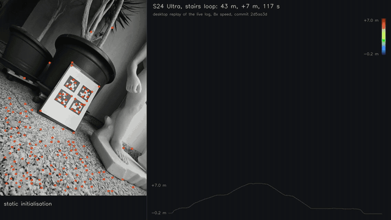
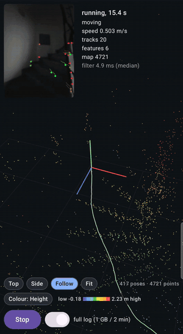
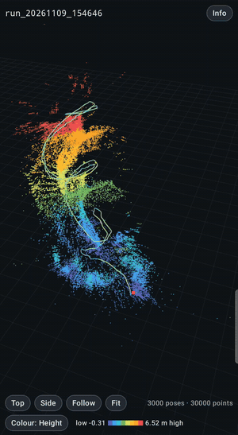
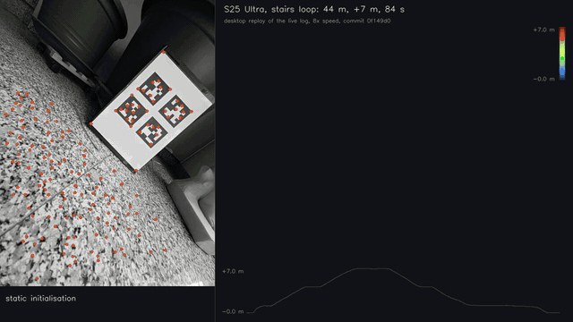
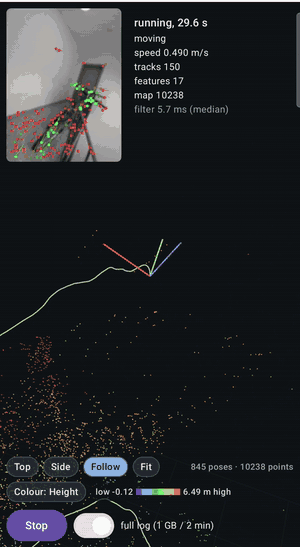
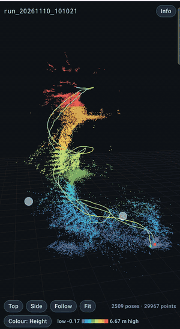

# Results

Every number on this page names its protocol. The protocol, in `docs/msckf.md`, `docs/calibration.md`, `docs/frontend.md`, `docs/dead_reckoning.md` or `docs/sensor_characterization.md`, holds the device, the build, the commit, the logs and the tool that produced it. Nothing here is estimated or projected: where something was not measured, the page says so.

**Truth on a phone.** There is no motion capture. Three references are used instead:
- **EuRoC MAV** on the desktop, with its ground truth: the same C++ core runs there.
- **AprilTags.** A printed 2×2 AprilTag sheet lies next to a taped spot. Each run starts and ends with the phone resting on that spot with the sheet in view. The board's pose solved from the first and the last frames gives the walker's true closure and the filter's error at the end, in position and attitude (`tools/apriltag_eval.py`, Protocol 16). The tags resolve millimetres within 0.6 m of the board.
- **Return to origin** for live runs without a log: the end position against the start.

**Desktop and live.** The phone records its own input (IMU, frames, camera metadata) when asked, and the desktop replay of that log is deterministic: bit-identical run to run, and the arm64 build reproduces the x86 run of EuRoC MH_01 to the last printed digit (Protocol 14); on a phone log with the online time offset the two differ at the rounding level, a few values in the sixth significant digit (Protocol 45). Live and desktop ends agree to 1–3 cm on most runs (Protocol 37 reading 6); where they differ, the protocol says by how much and why (reading 9).

## At a glance

| What | Result | Device | Protocol |
|---|---|---|---|
| Stairs loop: two floors up and down, 117 s | **0.29 m** end error after 43 m and a 7 m climb (0.68 % of the path), 0.23° attitude | S24 Ultra, live run, desktop replay, commit 2d5aa3d | 43 |
| The same stairs loop, 85 s | **0.22 m** end error after 44 m and a 7 m climb (0.49 % of the path), 3.5° yaw | S25 Ultra, live run, desktop replay, commit 0f149d0 | 46 |
| Walked room loops, 6–9.5 m, against ARCore on the same spot | pocketvio **0.116 m** / 0.4°, ARCore 0.004 m / 0.2° (median of 6 pairs) | S24 Ultra, release APKs 9490b92, 8403b79 | 37 |
| Fast hand spins, 10–17 rad/s peak, against ARCore | pocketvio **0.048 m / 1.1°**, ARCore 0.459 m / 93.1° (median of 5 pairs) | S24 Ultra, same | 37 |
| Single-frame jumps (a step implying > 3 m/s) | pocketvio **0 of 12 runs**, ARCore 10 of 12 | S24 Ultra, same | 37 |
| Ten logged loops, desktop replay | **0.055 m** median end distance | S25 Ultra, commit 3fb783c | 34 |
| Ten-minute static, zero-flow anchor | **1.0 cm** (0.26 m without the anchor); S25 Ultra 1.3 cm | both | 14, 17 |
| EuRoC MH_01 (MAV, 153 s) | ATE **0.235 m** | desktop, Release | 35 |
| GPU front-end: pyramid, FAST-9, KLT forward + backward of 150 tracks, 640×480 | **0.63 ms** (Adreno 750) / **0.53 ms** (Adreno 830) of GPU time per frame on the 3504 frames of the stairs log; the same tracks as the CPU reference to 0.014 px, and byte-identical tracks on the two GPUs | S24 / S25 Ultra | 45 |
| Filter per frame | **1.2 ms** of arithmetic on both phones (S24 Ultra: update 63 %, residuals 28 %, propagation 1 %); 3.7 ms median live on the S24 Ultra, 6–17 ms when the CPU clock is left low | S24 / S25 Ultra | 45 |
| Live per frame, median / p99 | front-end 6.8 / 15.5 ms, filter 3.7 / 10.6 ms of the 33 ms frame interval | S24 Ultra, the stairs run, screen recorder on | 43 |
| IMU delivery | **475 Hz**, 0 drops (event queue; no direct channel on this phone) | S24 Ultra; S25 Ultra 471.7 Hz | 1 |
| Camera–IMU time offset | **+0.5 ms** (S24 Ultra), +0.26 ms (S25 Ultra) | both | 3 |

## The stairs loop (Protocol 43)

  

The S24 Ultra held upright, walked from a taped spot on the ground floor up two floors of a stairwell and back, 117 s. It runs live on the phone; the log it recorded was replayed on the desktop and rendered above with `tools/render_run.py` (camera frames with the tracks coloured by age, the trajectory and the triangulated map points coloured by height, the height profile).

| | |
|---|---|
| path | 43.4 m in 3D (38.5 m horizontal), +6.96 m at the top |
| end error against the tags | **0.293 m** (0.238 m horizontal, −0.170 m vertical), rotation 0.23° |
| walker's true closure | 0.067 m |
| live against desktop | 5.3 cm at the end |
| live timing | IMU 475 Hz, 2 of 3501 frames skipped, 0 dropped |

Where the error is made: in the vertical scale. Measured with a tape (risers) and a laser rangefinder, the two floors are 5.93–6.00 m. Against that, the filter under-reads both directions: the climbs by 3.5–5.3 % and the descents by 0.9–2.6 %, on this run and on an earlier walk up the same stairs. The end's −0.17 m vertical is the difference between the two: the middle level is 7.5 cm lower coming down than going up, the same in the live run. The filter's vertical σ at the end is 1.7 cm against a 17 cm error. Where the under-scale comes from is open (Protocol 43 reading 6).

On the phone, the same run: the run screen (camera with tracks, live trajectory and map) and the run viewer afterwards (screen recordings, cropped):

  
  &nbsp;
  

### The same stairs on the S25 Ultra (Protocol 46)

  

The validation phone on the same route, from the same taped spot, with the shipped profile and the 1.0.0-rc1 APK, held upright, the screen recorder running. Faster: 85 s.

| | |
|---|---|
| path | 44.4 m in 3D (39.6 m horizontal), +7.03 m at the top |
| end error against the tags | **0.218 m** (0.217 m horizontal, +0.022 m vertical), rotation 3.5° (yaw) |
| walker's true closure | 0.034 m |
| live against desktop | 4.3 cm at the end |
| live timing | IMU 468 Hz, 2 of 2542 frames skipped, 0 dropped; filter 4.8 / 14.3 ms median / p99 |

Its error is horizontal and in yaw; the vertical closes to 2 cm. It reads each flight the same going up and coming down (within 3 cm), where the S24 Ultra's descents came out 1–2 % longer than its climbs. Both phones read the lower flight 3–5 % short of its measured height, the S25 Ultra in both directions, which points at the lower flight's riser measurement as much as at the filter (Protocol 46 readings 2 and open 1).

  
  &nbsp;
  

The S25 Ultra's run screen on the climb, and its run viewer at 2× speed through the colour modes: height, depth, parallax, residual and track length.

## pocketvio against ARCore (Protocol 37)

Paired runs on the S24 Ultra: one ARCore run and one pocketvio run per pair, the same path, spot and light, interleaved, both read against the same AprilTags. ARCore runs on camera 0, the main camera with OIS, which is the only camera it offers on this phone; pocketvio runs on the ultrawide. The comparison is ADR-0028's.

| | ARCore | pocketvio |
|---|---|---|
| loops (6 pairs), end error median | **0.004 m / 0.2°** | 0.116 m / 0.4° |
| fast spins (5 pairs), end error median | 0.459 m / 93.1° | **0.048 m / 1.1°** |
| runs with a single-frame jump (> 3 m/s implied) | 10 of 12 (12–141 cm, up to 164°) | **0 of 12** |
| tracking state reported through those jumps | 96.8–99.6 % TRACKING | — |

On loops ARCore wins the end error through its map: it relocalises onto its start. Its pose steps 12–27 cm in a single frame doing so, once while the phone lay still. On fast spins it snaps onto a wrong place in its map and carries on, reporting tracking throughout. pocketvio is odometry and cannot jump; it ends at its usual 1–1.5 % of the path. The end error alone favours SLAM, which is why the protocol adds the single-frame step.

## Loops, spins and statics on both phones

| Protocol | Runs | End error | Truth | Build |
|---|---|---|---|---|
| 31 | S24 Ultra: 6 fast spins, 6 walked loops, live under the blur budget (ADR-0024) | spins **0.123 m**, loops **0.058 m** (medians) | tags | release APK af321c0 |
| 31 | S25 Ultra: 6 fast spins | **0.072 m** | tags | same |
| 34 | S25 Ultra: 10 logged loops (Session 17), desktop replay with the accelerometer-to-gyroscope rotation (ADR-0026) | **0.055 m** median, 0.053 mean | return to the taped spot | commit 3fb783c |
| 36 | S24 Ultra: 2 live loops, 15 spins with the gyro scale (ADR-0027) | loops **0.084 m**; end yaw error over the spins 2.41° → **0.35°** | tags | release APK 6a5b84d |
| 26 | Hand spins, live, before the blur budget: S24 Ultra 12 / 6 rad/s, S25 Ultra 9.4 / 3.6 rad/s | 1.63 / 0.21 m; 0.083 / 0.061 m; no re-acquisition, tilt at rest 0.01–0.10° | tags | commit 7082624 |
| 14, 17 | ten-minute static with the zero-flow anchor (ADR-0018) | **1.0 cm** S24 Ultra, **1.3 cm** S25 Ultra | the spot | Protocols 14, 17 |

The same fast spin before the rate-proportional gyro noise (ADR-0023) ended 38.8 m away; the story is in [case-study-spin-runaway.md](case-study-spin-runaway.md).

## Calibration on the phone (Protocols 38–42)

The IMU's six-position fits and the checkerboard calibration run in C++ in the core, with no OpenCV. They match Python/OpenCV on the same data (Protocols 38–39) and run on the phone in a guided wizard (ADR-0031; 6.5 ms per frame of corner detection on the S24 Ultra). The wizard's camera fit on the S24 Ultra (338 views, 0.179 px RMS) is now the shipped profile. Replayed against the tags on 24 loops, it ends 1.0 cm closer than the previous profile (19 of 24 runs; Protocol 42). The accelerometer agrees with the shipped desktop calibration to 0.04 % of scale and 5 mm/s² of bias (Protocol 41).

## Limitations

- **Overconfidence.** The filter's covariance is too small: position NEES 4–7× the expected value on EuRoC (Protocols 9–11), a vertical σ of 1.7 cm against a 17 cm error on the stairs (Protocol 43), 3σ gaps on the blind stretches of fast spins (Protocol 37 reading 9). The accuracy holds; the uncertainty it reports does not.
- **No map, no relocalisation.** pocketvio is odometry. It does not close loops, so its error grows with the path (about 1 % on the walks above) where ARCore's returns to zero at a known place.
- **Two devices.** Both phones carry the same IMU (LSM6DSV) and Samsung's camera stack. Another phone gets a profile generated from its own camera and sensor data, which the wizard calibrates except for the noise (a conservative default; ADR-0032). Treated that way on the desktop, the two known phones lose nothing against their shipped profiles (Protocol 44). A third phone, a different IMU or a camera orientation other than 90° has not been tried.
- **Monocular, rolling shutter, static start.** The filter initialises at rest. The rolling shutter is in the low-parallax rows only, not in the main update. Seconds of fast rotation with no usable features are IMU-only.
- **EuRoC is the only external ground truth.** On the phones the truth is the AprilTag sheet at the ends of a run, so errors along the way are seen only through their effect at the end (the stairs' landings are the exception, Protocol 43).

---

## The record, phase by phase

The results as they were added, phase by phase, with their commits. Later protocols supersede some of the earlier figures; the tables above are the current ones.

**IMU-only dead reckoning (Phase 2, Protocol 5 in docs/dead_reckoning.md).** `pocketvio_replay --mode imu`, Release build, commit `fbadf25`+, configs with the measured Protocol 2 noise; 60 s logs recorded by the app.

| Log | Attitude | |p| error at 10 s | 30 s | 60 s |
|---|---|---|---|---|
| S24 Ultra, at rest on a desk | gravity-aided ESKF | 0.15 m | 1.44 m | 2.59 m |
| S24 Ultra, at rest | pure gyro | 0.17 m | 1.91 m | 8.54 m |
| S24 Ultra, at rest, raw accelerometer (no init-time scale correction) | gravity-aided | 6.07 m | 54.5 m | 213.6 m |
| S24 Ultra, 60 s handheld pan/tilt (true displacement < 1 m) | gravity-aided | 1.60 m | 11.4 m | 34.0 m |
| S24 Ultra, handheld | pure gyro | 5.86 m | 89.5 m | 445 m |
| S25 Ultra, handheld | gravity-aided | 1.33 m | 11.8 m | 45.6 m |
| EuRoC MH_01 (MAV, 162 s, vs. ground truth; commit `bd6827b`) | gravity-aided | 0.21 m | 2.06 m | 24.2 m |
| EuRoC MH_01 | pure gyro | 1.16 m | 41.4 m | 438 m |

Roll and pitch hold to a few tenths of a degree with gravity updates while the device is at rest or handheld; yaw is unobservable and drifts at the gyro's bias instability (≈ 2 °/h). Against MH_01's orientation ground truth the gravity-aided attitude has 1.15° roll/pitch RMS (0.8° of it is the dataset IMU's horizontal accelerometer bias, invisible to a static init) but yaw drifts at 0.97 °/s once the MAV flies: the norm gate cannot distinguish specific force from gravity and the update corrupts the gyro-bias estimate; the pure gyro keeps yaw to 0.043 °/s and loses tilt instead (18° after 162 s). Position is lost within seconds either way: that is the gap the camera closes in Phases 3–4.

**Camera import (Phase 3a, Protocol 6 in docs/frontend.md).** S25 Ultra, Adreno 830, 300 live frames at 640×480: zero-copy `AHardwareBuffer` import + YCbCr sampler + `copy_y` kernel = **0.41 ms** per frame (median, host round trip; kernel 18 µs by GPU timestamps), bit-exact against the CPU Y plane; CPU staging fallback 3.23 ms. S24 Ultra (Adreno 750): 0.79 ms zero-copy vs 3.43 ms staging, also bit-exact.

**Front-end kernels (Phase 3b, Protocol 7 in docs/frontend.md).** One command buffer per 640×480 frame, GPU timestamps, live frames: import + pyramid + FAST-9/NMS + KLT of 150 tracks = **0.38 ms on the S24 Ultra (Adreno 750), 0.26 ms on the S25 Ultra (Adreno 830)**; host round trip 1.2 / 0.7 ms. Pyramid and FAST bit-identical to the CPU references, KLT identical to 0.000 px on live frames (the references are unoptimised scalar code, and those timings were taken in the debug APK at `-O0`; see Protocol 7's caveat).

**Track manager (Phase 3c, Protocol 8 in docs/frontend.md).** EuRoC MH_01, all 3682 frames, CPU front-end, commit `243d317`: 150 tracks alive every frame; per frame 1.1 % of tracks lost by KLT, 0.6 % by the backward check, 0.3 % by RANSAC; a random observation belongs to a track **213 frames (10.7 s) long at the median**, while half of all tracks created die within 6 frames (slots on weak corners cycle until one sticks). The GPU driver produces the same ids as the CPU front-end to 0.0001 px (lavapipe, CI). On device: release APK, both phones propped up looking at a desk, 45 s at 30 fps: 0.47–0.57 ms of GPU time and **3.5–4.1 ms of host time per frame** including the backward-KLT round trip, the corner readback and the overlay thumbnail; the tracker update itself is 0.1 ms. Overlay: [docs/img/track_overlay_s24u.png](img/track_overlay_s24u.png).

**MSCKF (Phase 4; Protocols 9 and 10 in docs/msckf.md).** EuRoC, tracks from the CPU front-end, yaw + position aligned at init, 3–4 ms of CPU per frame:

| Sequence | ATE RMSE | RPE over 1 s, median | yaw drift | orientation NEES, ground-truth frame offset removed (expected 3) |
|---|---|---|---|---|
| MH_01, 153 s, accel density ×10 | **0.21 m** | 2.6 cm/s | 0.028 °/s | 20 |
| MH_02, 122 s, nominal densities | **0.26 m** | 3.1 cm/s | 0.002 °/s | 23 (12 with accel ×10) |
| V1_01, 143 s, nominal densities | **0.36 m** | 3.7 cm/s | −0.024 °/s | 215 (84 with accel ×10) |

The filter is accurate within the Phase 4 bar and still overconfident by a factor of 4–7. What Session 10 established by experiment: with ideal observations on MH_01's real track structure the filter is consistent in position (NEES 2.2) and the yaw drift vanishes, so MH_01's drift is in its tracks' pixel values; all three sequences' tracks lead the ground truth along the optical flow by 2–5 % of a frame (motion-blur centroid under auto-exposure, 1–2 ms equivalent and time-varying); V1_01's ground truth sits 2.5° from the IMU's gravity frame, which is why its ground-truth accelerometer bias reads 0.55 m/s² where the filter finds 0.13 like the other sequences; and the static-init covariance must carry the tilt–bias coupling or a 3° initial tilt destroys the run. Session 11 (Protocol 11) replaced the real pixels by ideal ones subset by subset and the ideal ones by synthetic error structures: white, correlated or per-track-offset noise on ideal tracks are all harmless, a fixed image-space systematic is not the cause, trimming track ends and limiting track age do nothing, and the real pixels' error is tied to the motion in a way none of them reproduces; a KLT template anchored at the feature's birth (ADR-0014) removes the tracks' random walk against the ground truth and halves MH_01's position NEES (15 → 7.4) without helping MH_02 or V1_01, so it is an option, not the default. The orientation NEES on EuRoC is bounded by the ground truth's own 0.3–0.4° wander, visible even with ideal observations. Session 12 (Protocol 12) added the IMU-centric pieces: a gyro-predicted warp of the KLT template (ADR-0015), which removes the rotational deformation of a feature's patch and takes a quarter off V1_01's ATE and NEES while leaving the slowly turning MH_01 alone; the camera–IMU time offset as a filter state (ADR-0016), which stays within its sigma of EuRoC's hardware zero on MH_01 and MH_02; and an in-flight IMU noise measurement against the ground truth (accelerometer six times the datasheet, gyro twice), which replaces the earlier ×10 guess and shows the IMU noise model is not what limits consistency. Session 13 (Protocol 13) added the extrinsics as a filter state (ADR-0017): on EuRoC they converge to within 0.1–0.2° and 1.5 cm of Kalibr's calibration from every start tried, including 3° and 5 cm off. The filter runs on the phone (`mode=vio`: GPU front-end on the camera thread, one filter thread, online time offset and extrinsics, trajectory canvas) with camera profiles derived from the phones' HAL calibration: **on the S24 Ultra a 6 m hand-held loop comes back to within 0.19–0.32 m of its start on three runs (0.41 m on the S25 Ultra, 0.37 m of it vertical, which points at its −1.7 % accelerometer scale), the phone is then held on the desk to millimetres per second, and the front-end plus filter take 10–11 ms of the 33 ms frame interval at the median (28–35 ms at the 99th percentile)**. The first two loops found two gaps in the stillness logic (a hand is never still for the IMU and gives no parallax; a phone put down carried a velocity error the update's own gate rejected) that the image flow now closes. The online time offset agrees with Session 3's cross-correlation within a millisecond once the exposure is in the frame time, and the extrinsics find the HAL's nominal camera-to-IMU rotation 2° off, repeatably. Session 14 (Protocol 14, desktop) measured two ideas carried over from the author's companion project: tightening the triangulation reprojection gate does detect the lagging tracks (MH_01's yaw drift falls from 0.027 to 0.006 °/s at 0.75 px and V1_01's position NEES halves) but starves the MH windows and costs accuracy there, so the 3 px default stays with the tight and the variance-relaxed gates as options; and a zero-flow pose anchor (ADR-0018: the clone of the frame on which the image went still is kept as the reference and the pose is measured relative to it while the features have not moved) bounds the position and the yaw of a static run where zero-velocity updates alone let them walk; on EuRoC it acts only on the ground and changes little. The same evening on the S24 Ultra: **the ten-minute static run ends 1.0 cm from its start with the anchor (26 cm before), with the filter's position sigma at 3 mm throughout**; the ultrawide was calibrated on a checkerboard (0.128 px RMS, focal length 1.8 % below the HAL value, docs/calibration.md); the accelerometer's +1.4 % at rest turned out to be a 0.16 m/s² bias plus 0.2 % of scale in a twelve-orientation calibration (ADR-0019), now applied at the boundary; a static recording replayed on the desktop exposed features triangulated from KLT drift at 10–20 cm of depth, now rejected by a minimum camera baseline (ADR-0013 §12b); and the replay built for arm64 reproduces the x86 MH_01 run to the last printed digit on the S25 Ultra. Session 15 (the next morning) gave the live filter a switch to log its own input, walked seven loops and replayed the logged ones on the desktop under six configurations: **live and desktop agree to 1.5–7.6 cm at the end of the same loop**, the checkerboard intrinsics cut the closure error by a factor of 3.3 against the HAL values on the same data (median 0.088 against 0.291 m over eight logged loops) and remove the vertical error the HAL camera leaves on every loop (0.12–0.38 m low), the accelerometer calibration and the anchor do not change the loop closure, and **the return-to-origin error over ten live loops of about 7 m is 0.04–0.38 m, median 0.20 m, with one divergence at lift-off**. Three controlled lift-and-set-down tests close to 1–3 cm at every speed, so the vertical error was the camera model, not the rolling shutter. Session 16 (Protocol 16, desktop) put an AprilTag truth under the eight logged loops (`tools/apriltag_eval.py`: board PnP at 0.52 m, 0.1–2 mm of PnP noise): **the walker's true closure is 0.2–1.0 cm on every loop, so the figures above are the filter's error**, and the per-frame series shows where it is made — the estimate moves 4–12 cm and +0.9 to +2.9° of yaw *while the phone lies still at the end*, a correction through the walk's cross-covariances driven by a gyro bias that drifts 0.2–0.35 mrad/s in two minutes of a warming phone against an Allan random walk a hundred times smaller (a bias random walk thirty times the Allan value takes the end yaw error from 1.1–1.5° to within 0.4°, measured, not yet adopted); loop 4's 0.25 m vertical error is made in 3.5 s of dead reckoning while a hand settles the phone on the desk, neither still nor moving with parallax; and the lift-off divergences are a scale-excitation problem (a gentle lift accelerates at 0.1–0.3 m/s², an uncalibrated accelerometer bias is 0.16) that a tighter triangulation gate rescues once in three. A flow-bounded velocity measurement for the frames without features (ADR-0020: the rotation-compensated flow scaled by the recently triangulated scene depth) halves loop 4's settling error, rescues two of the three divergences and leaves the median closure where it was (0.088 → 0.090 m). Session 17 (Protocol 17, S24 Ultra, live and logged) ran the rotation stress the debrief asked for: the phone spun in the hand about its three axes at 1.5 to 9 rad/s and set back on its spot **diverges at every rate (150 m to 1 km at the end, live and in the desktop replay of the same data)**, because a rotation about the hand gives a monocular filter no parallax and leaves it IMU-only for the 40–50 s of spinning; below 4 rad/s the tracker keeps its 150 tracks and the triangulation gate correctly rejects ten times more features than it accepts, at 8 rad/s the 40 px of motion blur stops the tracker first, and the flow-bounded velocity helps by a factor of three without fixing it, since rotation flow is not translation. Three more logged loops with a yaw turn over the desk close to 0.12–0.28 m live (the walker's own closure 2–5 cm by the tags); the desktop replays of the same data part from the live run only inside the ten seconds of that turn, which is the same no-parallax regime at 2.6 rad/s. The S25 Ultra, calibrated the same evening on the checkerboard (0.120 px RMS) and ten accelerometer orientations, **holds the ten-minute static to 1.3 cm with the anchor and closes ten logged loops of the same path to 0.02–0.20 m, median 0.085 m, with no divergence**; the desktop replays agree with the live runs to 3 cm on all ten, and the phone's HAL camera profile on the same data ends 0.06–0.27 m low on every loop (median 0.178 m), so the checkerboard is the single largest factor on both phones. Sessions 18–21 (Protocols 18–25, desktop replays of the same logs) took the spins apart: a run-away is now detected and re-acquired from a certain rest (ADR-0021), the hover's scene depth is held through a turn and its speed bound is that of a turning hand (ADR-0020 §8–§9), zero-parallax tracks measure rotation as anchored inverse-depth rows (ADR-0022), and the thing underneath turned out to be the attitude covariance: after thousands of degrees of hand rotation the filter carried a 5° tilt with a 0.017° sigma, the gyro's rate-dependent residual that the Allan variance of a phone on a floor cannot contain. A rate-proportional gyro noise term (ADR-0023, `gyro_rate_noise` 2e-4 /√Hz, swept on seven spins and 27 reference logs) **closes all seven logged spins to 0.02–1.8 m without a re-acquisition** (371, 14 and 6.4 m before on the fast ones), leaves the S24 Ultra loops where they were (8-loop median 0.088 m), improves the S25 Ultra's (0.081 → 0.052 m) and MH_01's ATE and consistency (0.235 → 0.234 m, NEES 57 → 56); the live confirmation on the phones is still to come. The whole history of that problem, from the first diverging spin to the covariance term that fixed it, is told for an outside reader in [docs/case-study-spin-runaway.md](case-study-spin-runaway.md). Two negative results of the same sessions: the gyro's scale is right to about 0.2 % on every axis (the filter replayed with a scaled gyro is worst away from unity), so the −1.7 % a vision-against-gyro fit reads at 2–3 rad/s is the tracker under motion blur; and the 3–4 % "under-scale" of the filter against the AprilTag board over the final approach was the board's PnP beyond a metre (3–10° of orientation error on 18 px tags), not the filter. Plot: [docs/img/vio_euroc_mh01.png](img/vio_euroc_mh01.png); on-device screen: [docs/img/vio_screen_s24u.png](img/vio_screen_s24u.png).

**On-device visual-inertial results (Phase 5, Protocols 14 and 16 in docs/msckf.md).** S24 Ultra, release build, `configs/s24u.yaml` (checkerboard intrinsics, twelve-orientation accelerometer calibration), commit `abc314c` for the live runs and `7e49308`+ for the evaluation; the room is 6.5 × 3–4 m, the phone is lifted 0.7–0.9 m and put back on a taped spot with the AprilTag sheet in view.

| Protocol | Runs | Return-to-origin error | Truth |
|---|---|---|---|
| ten live loops of about 7 m, 60–80 s | 10 | 0.04–0.38 m, median **0.20 m**, one divergence at lift-off | walker's closure ≤ 1 cm by AprilTag on the eight logged loops |
| the eight logged loops replayed on the desktop (same data as live) | 8 × 6 variants | median **0.088 m** calibrated (0.291 with the HAL camera model); live and desktop agree to 0.8–7.6 cm | filter error against the sheet equals the closure to within 1 cm |
| ten-minute static with the zero-flow anchor | 1 | **0.010 m** (0.26 m without) | — |
| lift-and-set-down, slow / fast | 3 | 0.011–0.028 m | — |

The S25 Ultra was calibrated and walked ten loops of its own in Session 17 (live median 0.085 m; `docs/msckf.md`).

Four of its six Session 25 loops then drifted 0.18–0.33 m *after* being set down, while lying still: the walk leaves an accelerometer-bias error that the Allan random walk of a phone at rest cannot absorb (Protocol 32). ADR-0025 first let the bias walk faster in proportion to the turn rate, and not at all at rest: replayed on the desktop (Release, WSL2 GCC 13, commit `55b82a5`, `--accel-rate-rw 4e-4`), the six loops ended 0.095 m from the AprilTag truth (median, was 0.231 m) and the S24 Ultra's six 0.063 m (was 0.058 m) (Protocol 33). The cause turned out to be a rotation of the accelerometer's frame against the gyroscope's, 7.7 mrad on the S25 Ultra and 4.9 mrad on the S24 Ultra, which the six-position fit cannot see. It is now measured on the same six-position logs and applied at the boundary on the S25 Ultra, in place of ADR-0025's term (ADR-0026). Replayed the same way (commit `3fb783c`), the six loops end 0.071 m from the tags, and the ten Session 17 loops 0.055 m median, 0.053 mean (were 0.046 / 0.065). On the S24 Ultra the rotation (4.7 mrad) pays only together with a gyro scale per axis (−0.24 / −0.34 / −0.12 %, the same on two calibration dates 16 days apart), measured by the same fit and applied at the boundary as well (ADR-0027). With both, its eight Session 25 spins end 0.062 m from the tags (were 0.099 m) and its six Session 25 loops 0.052 m (were 0.063 m). Three older spins recorded under auto-exposure get worse within their known ±0.4 m scatter (Protocol 35). ADR-0025's term is now off on both phones, and MH_01 is unchanged. Live on the S24 Ultra (Protocol 36: release APK at commit `6a5b84d`, six runs, each replayed on the desktop under the old and the new profile and read against the tags), the scale shows up first in the heading: the end yaw error is smaller on 22 of 23 tagged S24 Ultra runs, median 2.41° → 0.35° over fifteen spins. The two live loops end 0.084 m from the tags (median, 0.113 m under the old profile), while the spin end position is flat over all fifteen spins (0.080 → 0.078 m): the auto-exposure losses come with a correct heading, so they are not the gyro's.

**Hand spins (Phase 6, Protocols 17–26 in docs/msckf.md; the full story for an outside reader in [docs/case-study-spin-runaway.md](case-study-spin-runaway.md)).** The phone lifted from its spot, turned about all three axes for 20 s and set back, 90 s runs live on the phone, commit `7082624` (ADR-0023 rate-proportional gyro noise): S24 Ultra 12 rad/s peak **1.63 m**, 6 rad/s peak **0.21 m**; S25 Ultra 9.4 rad/s **0.083 m**, 3.6 rad/s **0.061 m**; no re-acquisition, tilt at rest 0.01–0.10° against the accelerometer, true closure by the tags 0.4–2.7 cm. The same fast spin before the noise term (Session 19, 10.2 rad/s) ended 38.8 m away. The remaining error of the fastest spin is a position slide during the seconds when the 20 ms exposure blurs every track (about 60 px at 12 rad/s); with the exposure set from a blur budget and the gain holding the brightness (ADR-0024, Protocol 27) the same spin closes to **0.455 m** live, and a walked loop under it is unchanged (0.136 m against the tags). Repeated live under the option (Protocol 31, release APK `af321c0`, against the tags): S24 Ultra six fast spins median **0.123 m**, six walked loops 0.058 m; S25 Ultra six fast spins 0.072 m. Since Session 26 the blur budget (4 px) is the profile default on both phones.
